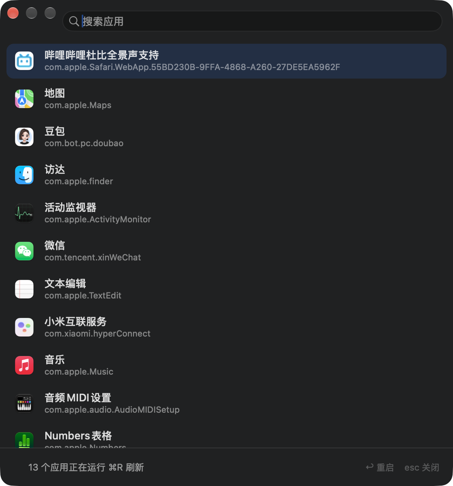

# WH-2：应用重启器

[](https://github.com/drdr19/wh-2-app-restarter/actions/workflows/build.yml)


一个用完即走的 macOS 小工具：**选中任意正在运行的应用，一键把它彻底关掉再重新打开。**

卡死的微信、加载不出来的浏览器、抽风的开发工具——不用再手动 Cmd+Q 然后去 Dock 里找回来。


## 安装

1. 双击 `dist/WH-2-AppRestarter.dmg`
2. 把「WH-2：应用重启器」拖进「应用程序」文件夹
3. 完成（无需任何配置）

## 使用

1. `⌘空格` 唤起聚焦搜索，输入「WH」或「重启」，回车
2. 列表里会出现当前所有正在运行的应用
3. 输入名字可以过滤，`↑` `↓` 选择，`↩` 重启（也可以直接双击）

重启完成约 1 秒后，工具自己会关闭，Dock 图标随之消失，不留任何东西在后台。

## 关于 Dock 图标

运行期间它是一个**正常的前台应用**：Dock 里会出现图标（紫色循环箭头），点它能把窗口叫回前台，
`⌘Tab` 也能切到它，`⌘Q` 退出。

窗口一关，App 就退出，Dock 图标也跟着消失——这是刻意的，避免在 Dock 里长期占位。

> 想让它**常驻**在 Dock（不运行也一直在）：Dock 上右键图标 → 选项 → 在 Dock 中保留。

命令行模式（`--restart`）是例外：它以纯后台形态运行，不显示 Dock 图标，也不抢焦点。

| 操作 | 快捷键 |
| --- | --- |
| 重启选中的应用 | `↩` 或双击 |
| 清空搜索 / 退出 | `esc`（有搜索词时先清空，再按一次退出） |
| 刷新列表 | `⌘R` |
| 直接退出 | `⌘Q` |

## 关闭策略

按「先温和、再强制」三档递进，保证一定关得掉：

1. **请求退出** —— 发送系统标准的退出事件，应用有机会保存文件
2. **终止信号** —— 3 秒内没有响应就发 `SIGTERM`
3. **强制结束** —— 再等 0.8 秒仍不退出，`SIGKILL` 兜底

> 关于第 1 档：macOS 要求「控制其他应用」必须获得用户授权。首次使用时系统可能弹出
> 「WH-2：应用重启器想要控制 ×××」，点**允许**即可让应用走正常的保存后退出流程。
>
> 如果没授权（或点了不允许），工具会记住这个应用「不响应退出事件」，之后直接走
> 第 2 档，只用 1.2 秒就完成，不会让你干等。
>
> 授权记录和 App 签名绑定。如果重新编译过 App，需要在
> `系统设置 → 隐私与安全性 → 自动化` 里重新授权。

## 命令行用法

适合写进脚本或快捷指令：

```bash
"/Applications/WH-2：应用重启器.app/Contents/MacOS/WH-2：应用重启器" --restart com.tencent.xinWeChat
```

退出码：`0` 成功，`1` 失败，`2` 目标未运行。

## 项目结构

```
restart-app/
├── src/
│   ├── main.swift                  # 入口：常规 UI / --restart 无界面模式
│   ├── AppDelegate.swift
│   ├── MainWindowController.swift  # 窗口、搜索、列表、快捷键
│   ├── AppCellView.swift           # 列表行样式
│   ├── RunningAppsProvider.swift   # 枚举正在运行的应用
│   ├── RestartEngine.swift         # 三档关闭策略 + 重新拉起
│   └── HeadlessRunner.swift        # 命令行模式
├── scripts/
│   ├── build_app.sh                # 双架构编译 → icns → 签名 → DMG
│   ├── make_icon.swift             # 生成 1024 图标
│   ├── make_dmg_background.py      # 生成 DMG 背景图
│   └── dmgbuild_run.py
└── assets/
```

## 自行构建

```bash
export PATH="/Users/cuihao/.workbuddy/binaries/python/envs/default/bin:$PATH"   # dmgbuild 所在
APP_NAME="WH-2：应用重启器" BUNDLE_ID="cn.cuihao.app-restarter" DMG_NAME="WH-2-AppRestarter.dmg" \
  bash scripts/build_app.sh
```

产物：`dist/WH-2-AppRestarter.dmg`（通用二进制，Intel / Apple Silicon 都能跑）。

## 实现要点

- **枚举应用**用 `NSWorkspace.runningApplications`，只取 `activationPolicy == .regular`，
  排除自己和无界面的后台进程
- **重新拉起**前必须先等旧实例从 LaunchServices 消失，否则会报
  `miscellaneous error`（已内置等待 + 退避重试）
- **访达**由 launchd 托管，退出后系统会自动拉起，不需要也不应该手动 `open`
- 判断进程死活用 `kill(pid, 0)`，比 `NSRunningApplication.isTerminated` 更及时
